# Pipeline gitlab
## À propos

### Gitlab.com

Pour ces TP, nous allons utiliser https://gitlab.com et pas l'instance universitaire https://gitlab.univ-lille.fr, car certaines fonctionnalités n'ont pas été activées sur l'instance universitaire.

Vous avez toutes et tous reçu une invitation à créer un compte ou à ajouter votre mail universitaire sur votre compte gitlab.com, ce qui vous donne accès à un groupe de la forme https://gitlab.com/univlille/iut-info/r5.04/2026-2027/nom-prenom

Dans ce groupe, faites un fork (une bifurcation) de ce projet, que vous nommerez `tp1`, et dans lequel vous allez travailler.

## Environnement de travail

Ce TP nécessite d'exécuter des containers docker et de travailler avec un dépôt git en local. Deux environnements sont possibles, au choix :

### Option 1 : une machine à l'IUT

Connectez-vous en ssh à la machine de l'IUT :

```shell
ssh votre-login@tp.iutinfo.fr
```

Puis rebondir sur une machine dans les salles de TP. 

### Option 2 : votre machine personnelle

Vous pouvez également travailler sur votre propre machine, à condition d'installer :

* **git** : https://git-scm.com/downloads
* **docker** : https://docs.docker.com/get-docker/ ou **podman** : https://podman.io/

### Récupérer le projet

Quelle que soit l'option choisie, commencez par cloner votre fork pour travailler en local :

```shell
git clone https://gitlab.com/univlille/iut-info/r5.04/2026-2027/groupe-X/nom-prenom/tp1.git
cd tp1
```

Comme vu en amphi : sur une machine vierge, **cloner le dépôt + 1 commande = je peux travailler**. Tout au long du TP, vous éditerez vos fichiers localement, puis vous commiterez et pousserez avec git :

```shell
git add .
git commit -m "votre message"
git push
```

Dans la suite du TP, l'ensemble des commandes de containers peut être lancé indifféremment avec docker ou podman (podman est l'équivalent libre de docker, installé sur les machines de l'IUT).

## Auto évaluation

À la fin de ce TP, je dois être capable de :

* expliquer le fonctionnement des jobs gitlab, le couplage avec les containers applicatifs et le code hébergé sur gitlab
* expliquer le fonctionnement dans le cadre de l'IUT (docker/podman, redirection de ports, etc.)
* créer des jobs simples en partant d'un container debian,
* conditionner l'exécution d'un job,
* publier un site web statique associé à mon projet,
* construire un container applicatif de mon projet et le tester en local,
* publier un container applicatif associé à mon projet sur la registry gitlab.com

Si à la fin du TP, je ne suis pas capable de faire tout ça en totale autonomie **sans faire de copier-coller**, sans avoir besoin de relire la documentation, je refais le TP et je demande de l'aide aux profs.

## Q1 Mon premier job

* **Pourquoi** : exécuter un job gitlab-ci et en comprendre le fonctionnement
* **Comment** : créer un job, le lancer, le modifier, le faire échouer, etc.

Dans l'esprit des boucles de feedback rapides vues en amphi : à chaque `git push`, gitlab-ci va automatiquement vérifier votre code. Commençons par de premiers jobs très simples pour comprendre le mécanisme.

### Q1.1

En éditant le fichier `.gitlab-ci.yml`, créez un premier job qui s'exécute dans un container `debian:stable`, nommé `mon-job-echo`, et qui va lancer les commandes `cat /etc/debian_version` et `echo "Jusque ici tout va bien"`.

**Vérification** :

Dans Build > Pipeline, vous devez pouvoir voir votre premier pipeline :

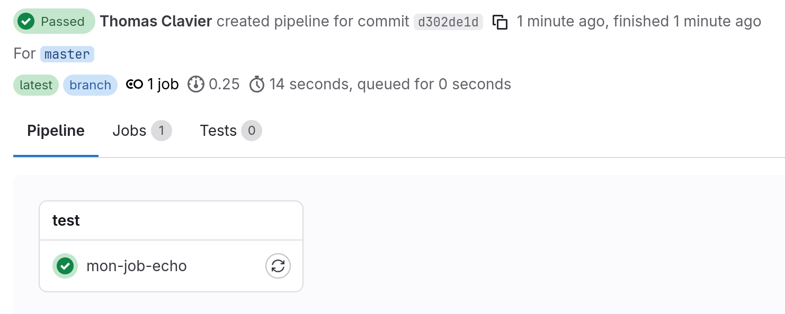
et dans les logs du job `mon-job-echo` vous devez pouvoir lire :

```
$ cat /etc/debian_version
13.1
$ echo "Jusque ici tout va bien"
Jusque ici tout va bien
```

(Le numéro de version affiché peut être différent selon la date d'exécution du TP.)

### Q1.2

En éditant le fichier `.gitlab-ci.yml`, ajoutez un second job qui s'exécute dans un container `debian:stable`, nommé `mon-job-ok`, et qui va lancer la commande `echo "Jusque ici tout va bien"`.

**Vérification** :

Dans Build > Pipeline, vous devez pouvoir voir votre pipeline :

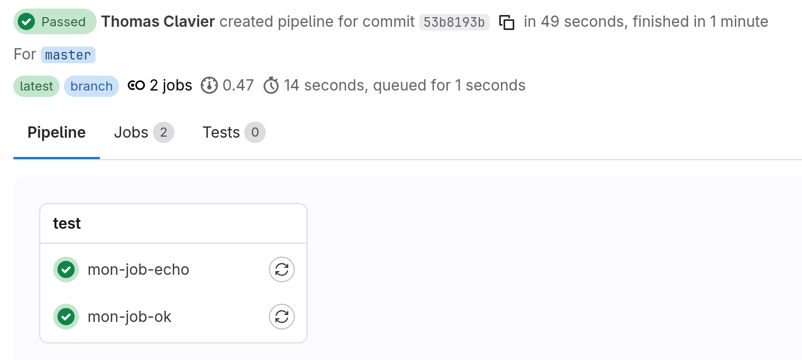
et dans les logs du job `mon-job-ok` vous devez pouvoir lire :

```
$ echo "Jusque ici tout va bien"
Jusque ici tout va bien
```

### Q1.3

En éditant le fichier `.gitlab-ci.yml`, ajoutez un troisième job qui s'exécute dans un container `debian:stable`, nommé `mon-job-ko`, et qui va lancer les commandes `echo "Mais l'important, c'est pas la chute. C'est l'atterrissage"` et `exit 1`.

**Vérification** :

Dans Build > Pipeline, vous devez pouvoir voir votre pipeline :

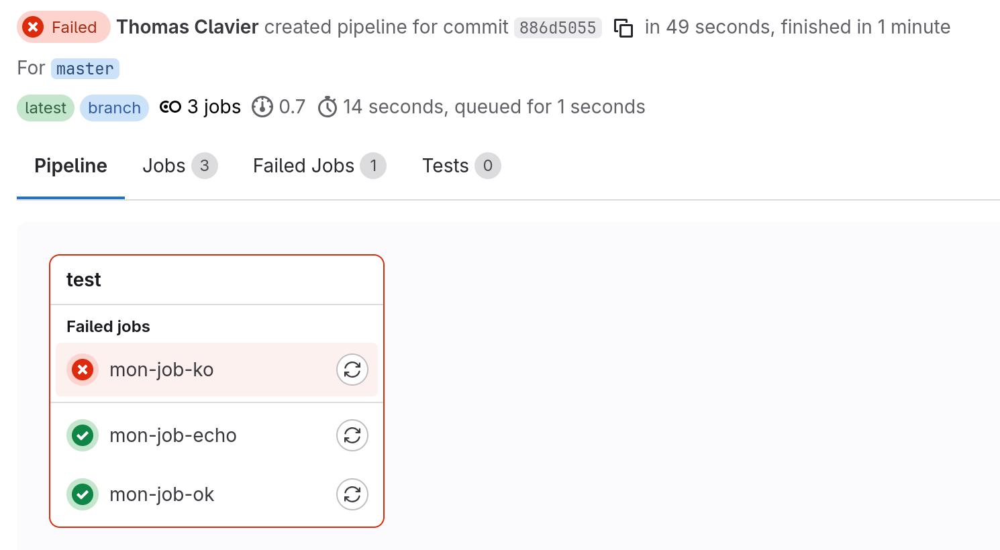
et dans les logs du job `mon-job-ko` vous devez pouvoir lire :

```
$ echo "Mais l'important, c'est pas la chute. C'est l'atterrissage"
Mais l'important, c'est pas la chute. C'est l'atterrissage
$ exit 1
Cleaning up project directory and file based variables 00:01
ERROR: Job failed: exit code 1
```

En regardant le résultat du pipeline, que pouvez-vous en conclure sur l'exécution des jobs ?

### Q1.4

Mettez le job `mon-job-ko` dans un stage `étape 1`, le job `mon-job-ok` dans un stage `étape 2` et le job `mon-job-echo` dans un stage `étape 3` pour obtenir le pipeline suivant :

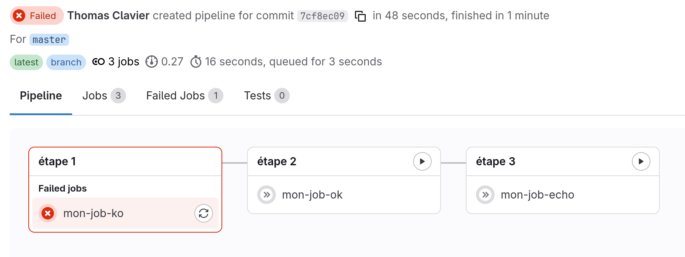

Testez le comportement de votre pipeline.

En regardant le résultat du pipeline, que pouvez-vous en conclure sur l'exécution des étapes ?

ℹ️ : le cours présente aussi la directive `needs:` pour créer des dépendances directes entre jobs, sans passer par les stages. Dans ce TP, on s'en tient aux stages.

### Q1.5

Corrigez le job `mon-job-ko` pour qu'il ne retourne plus de code d'erreur et retrouvez un pipeline totalement opérationnel :

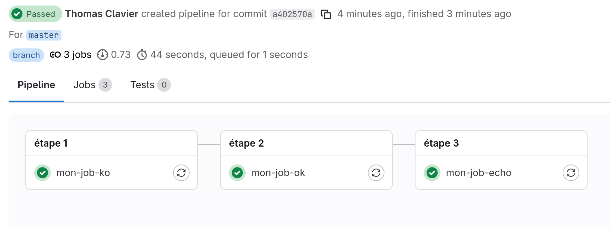

Vérifiez le comportement de votre pipeline.

### Q1.6 Apprenons à mettre un job en commentaire

Commentons la totalité du pipeline afin de préparer le terrain pour la prochaine question. Pour ce faire, renommez tous vos jobs en les préfixant d'un point : `.mon-job-ko`, `.mon-job-ok`, `.mon-job-echo`.

**Vérification** : vous devez obtenir le pipeline suivant :

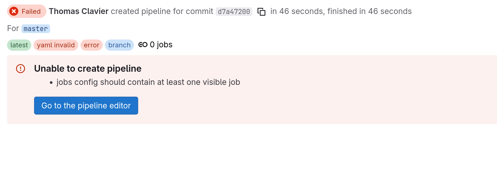

## Q2 Mon premier job `pages`

### Q2.1 - Un site privé

* **Pourquoi** : publier un site web statique associé au projet (documentation, rapport d'analyse ou même site institutionnel).
* **Comment** : en utilisant la fonctionnalité de déploiement des pages gitlab.

Créez un nouveau job pour voir apparaitre la page html suivante sur https://univlille.gitlab.io/iut-info/r5.04/2026-2027/groupe-X/nom-prenom/tp1/

```html
<html>
<head>
  <title>TP1 de Prénom Nom</title>
</head>
<body>
  <h1>Pipeline gitlab</h1>
  <ul>
   <li><a href="readme.html">Le sujet</a></li>
  </ul>
</body>
</html>
```

Commencez par lire la documentation officielle : https://docs.gitlab.com/ee/ci/yaml/#pages

Notez que le job standard `pages` permet de publier un dossier nommé `public` contenant l'ensemble d'un site web statique.

Pour obtenir l'URL demandée, rendez-vous dans **Deploy > Pages** et décochez la case "Use unique domain"

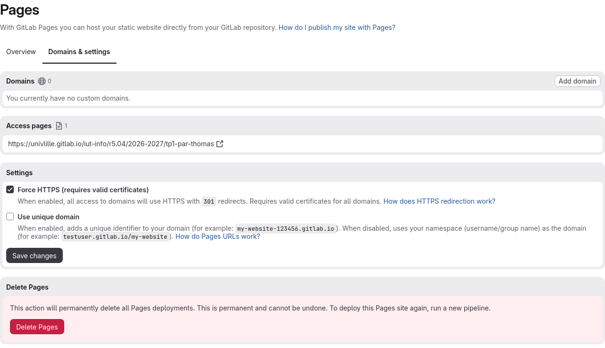

**Vérification** : visitez l'URL https://univlille.gitlab.io/iut-info/r5.04/2026-2027/groupe-X/nom-prenom/tp1/ avec votre navigateur préféré.

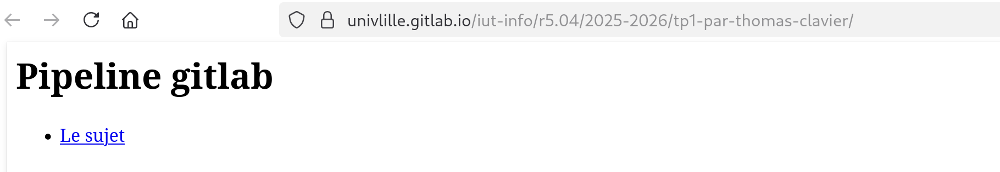

### Q2.2 - Un site public

Rendez le site web accessible pour tous, sans rendre votre projet public.

ℹ️ : Rendez-vous dans **Settings > General**

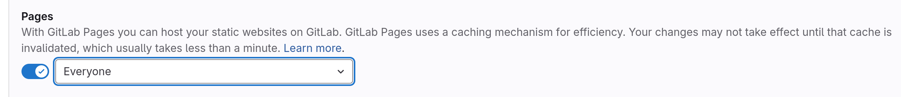

**Vérification** : visitez l'URL https://univlille.gitlab.io/iut-info/r5.04/2026-2027/groupe-X/nom-prenom/tp1/ depuis un onglet privé de votre navigateur préféré.

### Q2.3 - gitlab pages avec pandoc

Modifiez votre job pour qu'il génère le fichier `readme.html` à publier sur https://univlille.gitlab.io/iut-info/r5.04/2026-2027/groupe-X/nom-prenom/tp1/ à partir du fichier `README.md`.

Pour information, il est possible de générer du html depuis un fichier Markdown en utilisant [pandoc](https://pandoc.org/). La commande à utiliser est alors :

```shell
pandoc --standalone -f markdown+smart < fichier.md > fichier.html
```

Avec l'option `--css=style.css` il est possible de spécifier un fichier de style.

ℹ️ : vous allez probablement avoir besoin d'installer `pandoc`, n'oubliez pas l'option `-y` de la commande `apt` pour désactiver le prompt.

**Vérification** : visitez les 2 pages suivantes :

* https://univlille.gitlab.io/iut-info/r5.04/2026-2027/groupe-X/nom-prenom/tp1/
* https://univlille.gitlab.io/iut-info/r5.04/2026-2027/groupe-X/nom-prenom/tp1/readme.html

## Q3

Il est possible de conditionner le lancement d'un job.

Faites évoluer la chaîne d'intégration continue pour ne déployer que la branche principale.

Vérifiez, en faisant des modifications dans une branche de travail, que votre job de publication des pages ne se lance pas. Commencez par lire la documentation officielle : https://docs.gitlab.com/ee/ci/yaml/#rules

Dans la vraie vie, une équipe qui travaille en utilisant le workflow git "Feature branching" ou "Personal branching" ou le très vieillissant "GitFlow" se doit de ne déployer son site web que pour la branche principale.

## Q4 Docker

Notre programme est écrit en Go, seulement nous n'avons pas le compilateur go de disponible sur les machines. On va donc travailler dans un container docker (ou podman).

### Q4.1 - docker / podman

* Vérifiez que vous arrivez bien à lancer des containers docker : `podman run hello-world` (ou `docker run hello-world`)
* Prenez votre éditeur graphique favori et ajoutez le fichier `Dockerfile` avec juste la ligne `FROM debian` à l'intérieur.
* Puis lancez `podman build -t test .` (ou `docker build -t test .`), vous devriez voir :

```
STEP 1/1: FROM debian
Resolved "debian" as an alias (/etc/containers/registries.conf.d/shortnames.conf)
Trying to pull docker.io/library/debian:latest...
Getting image source signatures
Copying blob 15b1d8a5ff03 done   |
Copying config 999ffdddc1 done   |
Writing manifest to image destination
COMMIT test
--> 999ffdddc1
Successfully tagged localhost/test:latest
Successfully tagged docker.io/library/debian:latest
999ffdddc1528999603ade1613e0d336874d34448a74db8f981c6fae4db91ad7
```

### Q4.2

Construisez un `Dockerfile` pour packager l'application.

Pour information, c'est un projet en golang : il se compile avec n'importe quelle version de golang et les dépendances sont gérées par go lui-même. Vous pouvez donc utiliser ces commandes :

* Commande pour télécharger les dépendances, à lancer dans le dossier contenant le fichier `go.mod` : `go mod download`
* Commande pour construire le projet : `go build ./...`. On peut ajouter 2 options : `-v` pour avoir des détails de progression et `-o /path/to/file` pour récupérer le binaire dans le fichier `path/to/file`
* Commande pour lancer le service après compilation : `/path/to/file`

C'est un serveur web qui écoute sur le port 8080 et nous aimerions pouvoir le lancer avec la commande `podman run hello-go` (ou `docker run hello-go`).

**Vérification** :

* lancez votre container pour qu'il redirige le trafic du port 8081 de votre machine vers le port 8080 dans le container : `podman run -p 8081:8080 hello-go` (ou `docker run -p 8081:8080 hello-go`)
* visitez http://localhost:8081/

## Q5 - registry.gitlab.com

Maintenant que vous avez rédigé un `Dockerfile` pour construire l'application, nous allons demander à gitlab-ci de publier le container ainsi créé pour le rendre accessible à toutes les personnes ayant accès au projet.

Après avoir lu la documentation officielle : https://docs.gitlab.com/ee/ci/docker/using_docker_build.html#use-docker-in-docker

### Q5.1

Que contiennent les variables `$CI_REGISTRY_IMAGE`, `$CI_COMMIT_REF_NAME`, `$CI_JOB_TOKEN` et `$CI_REGISTRY` ?

Avec le job suivant :

```yaml
mon-job:
  ...
  services:
    - docker:dind
  ...
```

Que fait la directive services en général ? Et dans ce cas précis ?

Ajoutez un job, indépendant du précédent, pour construire le container de l'application et l'enregistrer sur la registry docker de gitlab.com.

**Vérification** :

Dans **Deploy > Container registry** vous devez voir votre container et son tag

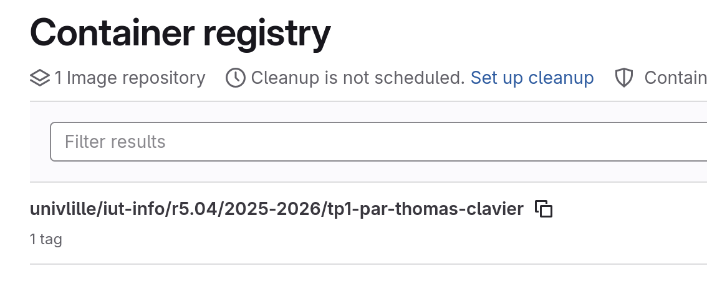

### Q5.2

Dans la vraie vie, une équipe qui travaille en utilisant le workflow git "Feature branching" ou "Personal branching" ou le très vieillissant "GitFlow" va avoir besoin de construire un container par branche.

En reprenant la documentation officielle des règles de déclenchement des jobs : https://docs.gitlab.com/ee/ci/yaml/#rules et celle sur les stages : https://docs.gitlab.com/ci/yaml/#stages

* Conditionnez le lancement de ce job pour qu'un container soit construit pour chaque branche
* Nommez le tag du container avec le nom de la branche
* Faites un alias `:latest` sur le container de la branche principale

**Vérification** :

Votre pipeline devrait ressembler à :

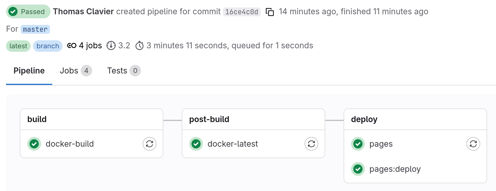

Dans **Deploy > Container registry** vous devez voir votre container et ses tags

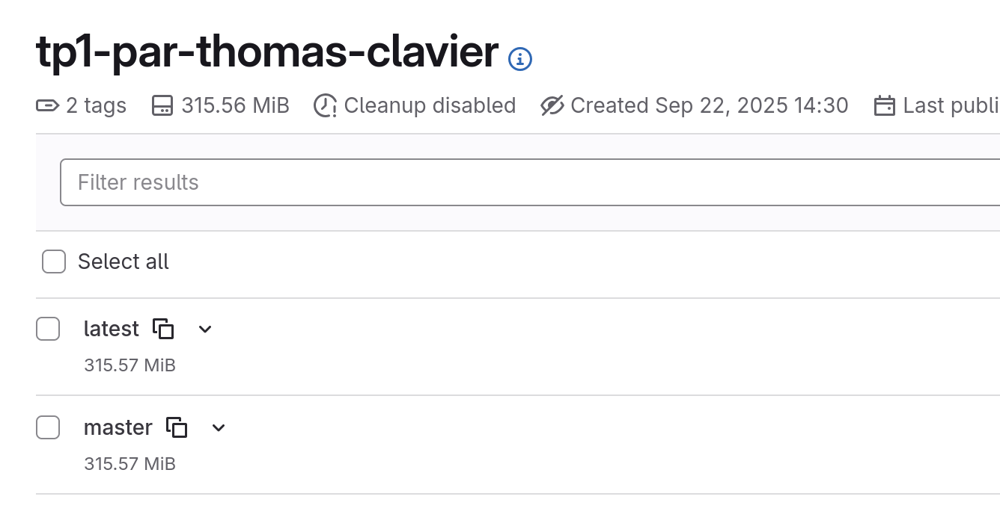

### Q5.3

Votre container est maintenant sur la registry gitlab.com, publié pour toutes les personnes y ayant accès.

* Commencez par créer un token d'accès : https://gitlab.com/-/user_settings/personal_access_tokens en ne lui donnant que le droit `read_registry`
* Identifiez docker (ou podman) sur la registry gitlab : `podman login registry.gitlab.com` (ou `docker login registry.gitlab.com`), renseignez votre login gitlab.com et votre token en guise de mot de passe.
* Vérifiez que vous arrivez bien à télécharger et exécuter votre container depuis votre poste.

**Vérification** : depuis votre poste, vous pouvez lancer `podman run -p 8080:8080 registry.gitlab.com/univlille/iut-info/r5.04/2026-2027/groupe-X/nom-prenom/tp1` (ou l'équivalent avec `docker`)

## Bilan

Revenez aux objectifs pédagogiques présentés en début de TP et vérifiez que vous êtes capable de tout refaire tout seul, sans être guidé pas à pas, sans faire de copier-coller, et sans avoir besoin de relire la documentation.

Imaginez par exemple que les questions 4 et 5 ne fassent qu'une et soient rédigées de la façon suivante : "Construire un Dockerfile pour packager l'application et le publier sur la registry docker de gitlab.com"
