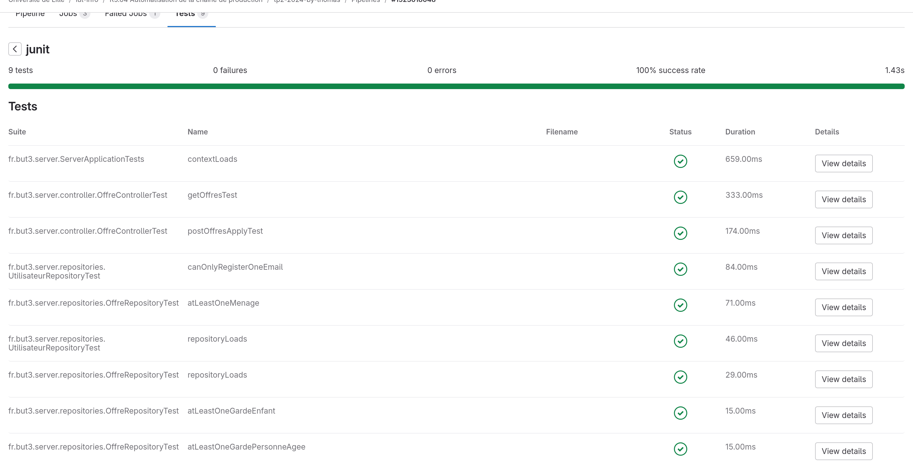
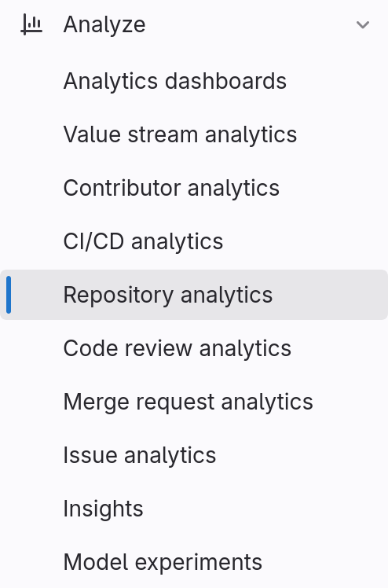
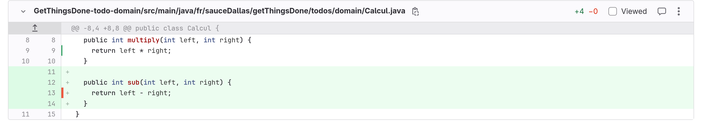
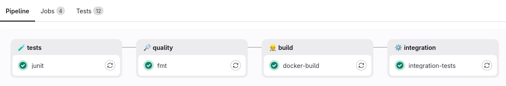

# Garantir la qualité logicielle : gestion des tests et respect des règles de développement

## À propos

La dernière fois, vous avez ajouté un pipeline sur un projet en Go. Cette fois-ci, nous allons ajouter un pipeline sur un projet de S6 de vos camarades de l'année dernière.

### Gitlab.com

Pour ces TP, nous utilisons https://gitlab.com et pas l'instance universitaire https://gitlab.univ-lille.fr, car certaines fonctionnalités n'ont pas été activées sur l'instance universitaire.

Vous avez toutes et tous reçu une invitation à créer un compte ou à ajouter votre mail universitaire sur votre compte gitlab.com, ce qui vous donne accès à un groupe de la forme https://gitlab.com/univlille/iut-info/r5.04/2026-2027/groupe-X/nom-prenom.

Dans ce groupe, faites un fork (une bifurcation) de ce projet, que vous nommerez `tp2`, et dans lequel vous allez travailler.

## Environnement de travail

Comme au TP1, ce TP nécessite d'exécuter des containers docker ou podman et de travailler avec un dépôt git en local. Deux environnements sont possibles, au choix :

* une machine à l'IUT : `ssh votre-login@tp.iutinfo.fr`, puis rebondir sur une machine dans les salles de TP ;
* votre machine personnelle, avec [git](https://git-scm.com/downloads) et [docker](https://docs.docker.com/get-docker/) ou [podman](https://podman.io/) installés.

Clonez ensuite votre fork pour travailler en local :

```shell
git clone https://gitlab.com/univlille/iut-info/r5.04/2026-2027/groupe-X/nom-prenom/tp2.git
cd tp2
```

Comme vu en amphi : sur une machine vierge, **cloner le dépôt + 1 commande = je peux travailler**. Tout au long du TP, vous éditerez vos fichiers localement, puis vous les commiterez et pousserez avec git :

```shell
git add .
git commit -m "votre message"
git push
```

## Auto-évaluation

À la fin de ce TP, je dois être capable de :

* créer un job qui lance les tests unitaires
* exécuter un job en local avec glci
* rajouter le reporting JUnit dans maven et dans l'interface de gitlab
* rajouter le rapport de couverture de code dans maven et dans l'interface de gitlab
* rajouter un job de formatage du code dans maven
* rajouter un job pour lancer des tests d'intégration avec au moins 1 service

Si à la fin du TP, je ne suis pas capable de faire tout ça en totale autonomie **sans faire de copier-coller**, sans avoir besoin de relire la documentation, je refais le TP et je demande de l'aide aux profs.

## Q1 - Lancer les tests unitaires

Un des objectifs de la chaîne d'intégration et de déploiement continu consiste à lancer l'ensemble des tests à chaque commit.

### Q1.0 - Lancer les tests en local

Nous avons un projet dont la gestion des dépendances et la compilation sont assurées par maven, pour lancer les tests, la commande est donc `mvn test` ou `mvn verify`.

* Commencer par lancer la compilation dans un container `maven:latest` : `podman run -it -v $(pwd):/workspace maven bash`, puis vérifier ce que fait la commande `cd /workspace && mvn test`.
* La compilation échoue car nous n'utilisons pas la bonne version de java (le message d'erreur affiché ne parle pas de version de java, c'est normal : fiez-vous au `pom.xml`).
* Analyser le fichier `pom.xml` pour trouver la version de java. Après avoir regardé [les versions disponibles du container maven](https://hub.docker.com/_/maven/tags), identifier le bon container à utiliser pour lancer la compilation en local.

**Vérification** : tout fonctionne quand vous pouvez voir ce log :

```
[INFO] Results:
[INFO]
[INFO] Tests run: 9, Failures: 0, Errors: 0, Skipped: 0
[INFO]
[INFO] BUILD SUCCESS
[INFO] ------------------------------------------------------------------------
[INFO] Total time:  57.876 s
[INFO] Finished at: 2026-11-05T11:30:03Z
[INFO] ------------------------------------------------------------------------
```

### Q1.1 - Le job

* Créer à la racine du dépôt le fichier `.gitlab-ci.yml` qui décrira votre pipeline, et y déclarer une première étape (stage) `🧪 tests`. Cette étape sera un préalable aux autres étapes. Si elle échoue, les autres étapes ne doivent pas être exécutées.
* Ajouter un job nommé `junit` associé à cette étape `🧪 tests`. Ce job lancera les tests au moyen de la commande `mvn test`.
* Vous pouvez alors voir dans les logs du job :

```
[INFO] Results:
[INFO]
[INFO] Tests run: 9, Failures: 0, Errors: 0, Skipped: 0
[INFO]
[INFO] BUILD SUCCESS
[INFO] ------------------------------------------------------------------------
[INFO] Total time:  57.876 s
[INFO] Finished at: 2026-11-05T11:30:03Z
[INFO] ------------------------------------------------------------------------
```

* Ajouter le test suivant dans le fichier `src/test/java/fr/but3/server/controller/OffreControllerTest.java`.

```java
    @Test
    public void test_that_wont_work() {
        assertTrue(false);
    }

```

* Vérifier que la chaîne de CI/CD s'arrête bien quand les tests échouent.

### Q1.2 - glci : exécuter le job en local

À chaque modification, il faut pousser pour déclencher le pipeline et attendre qu'un runner libre le prenne. [glci](https://gitlab.com/gitlab-org/ci-cd/runner-tools/glci) est un outil expérimental de gitlab qui exécute le pipeline **localement** : il simule le coordinateur et lance un vrai runner en container.

* Sur la page des [releases](https://gitlab.com/gitlab-org/ci-cd/runner-tools/glci/-/releases) du projet : un tag, des notes de version, des fichiers attachés — c'est exactement à ça que sert une **release** gitlab, vue en amphi 1
* Télécharger le binaire correspondant à votre machine (`glci-linux-amd64` sur les machines de l'IUT), le déposer dans un dossier (par exemple `~/bin`), le renommer en `glci` et le rendre exécutable : `chmod +x ~/bin/glci`
* `glci run junit` : le job échoue-t-il en local aussi ? Retrouvez l'échec de `test_that_wont_work` dans les logs, sans avoir poussé de commit
* Pour la suite du TP, vous pouvez tester vos jobs en local avant de pousser (`glci run --watch` relance le pipeline à chaque modification du dépôt)

**Vérification** : vous savez faire passer le job `junit` au rouge sans pousser de commit.

ℹ️ : avec podman, le socket docker-compatible doit être actif (`systemctl --user enable --now podman.socket`) et glci se configure avec `engine = "podman"` dans `~/.glci/config.toml`.

ℹ️ : si la commande `glci` n'est pas trouvée, votre dossier n'est pas dans le `PATH` : `export PATH="$HOME/bin:$PATH"`.

ℹ️ : glci est expérimental — si l'installation ou l'exécution échoue sur votre machine, continuez le TP en poussant normalement, ce n'est pas bloquant.

## Q2 - Ajouter le reporting JUnit

Dans la question précédente, votre pipeline s'est arrêté parce qu'un test a échoué. Si vous voulez connaître le détail des erreurs générées par les tests, vous êtes obligé·e d'afficher le log du job correspondant et de retrouver l'erreur, ce qui n'est pas très pratique.

Pour rendre les choses plus simples, nous allons intégrer à gitlab le rapport généré par JUnit.

* En vous aidant de la [documentation sur les rapports JUnit](https://docs.gitlab.com/ee/ci/testing/unit_test_reports.html), ajouter la récupération du rapport de test à votre job `junit`.

Les rapports de tests sont des fichiers XML générés par JUnit. La [documentation du plugin `surefire`](https://maven.apache.org/surefire/maven-surefire-plugin/index.html) vous indiquera où ces fichiers sont générés.

Si tout se passe bien, vous devriez obtenir le résultat suivant en allant dans **Build > Pipelines**, puis sur l'onglet **Tests** de la dernière exécution :



En cliquant sur le nom du job, vous pourrez accéder au détail des tests et de leurs résultats.

Faire repasser le job au vert en corrigeant le test `test_that_wont_work`.

## Q3 - Couverture de test

Afin de voir le badge de couverture de tests ainsi que le suivi de la couverture de tests (Analyze > Repository analytics) et le diff enrichi dans les Merge Requests, nous allons ajouter la couverture de test.

### Q3.0 - Configuration de jacoco

En Java, le calcul de la couverture de test se fait très souvent avec JaCoCo. En suivant la documentation officielle du plugin maven jacoco, configurer le fichier `pom.xml` pour générer un rapport de couverture de test avec la commande `mvn jacoco:prepare-agent verify jacoco:report`.

Vous pouvez vérifier que tout fonctionne bien en ouvrant dans un navigateur les quelques pages html de rapport générées par jacoco : `target/site/jacoco/index.html`

ℹ️  - La documentation officielle du plugin maven jacoco : https://www.eclemma.org/jacoco/trunk/doc/maven.html

ℹ️  - Pour trouver quelles sont les versions disponibles d'un module maven, par défaut, il suffit de rechercher sur [maven central](https://central.sonatype.com/). Par exemple en recherchant jacoco (https://central.sonatype.com/search?q=jacoco), identifiez la dernière version stable de JaCoCo.

N'oubliez pas qu'il est possible de tester en local avec podman : `podman run -it -v $(pwd):/workspace ...`

### Q3.1 - Le badge de couverture de test

* Ajouter le badge de couverture de test.
* Adapter le script du job `junit` : il doit maintenant générer le rapport de couverture et l'afficher dans sa sortie standard.

ℹ️  - La documentation officielle de gitlab sur les badges : https://docs.gitlab.com/ee/user/project/badges.html

ℹ️  - La page [Code coverage](https://docs.gitlab.com/ee/ci/testing/code_coverage/) de la documentation gitlab distingue les deux mécanismes de couverture : le pourcentage (badge, historique) et la visualisation ligne par ligne dans les merge requests.

🎓 - Rappel de cours : la directive `coverage` du fichier `.gitlab-ci.yml` exploite le stdout du script du job. On définit dans la directive `coverage` une expression régulière qui sera utilisée pour analyser la totalité de la sortie standard du script du job. Comme la couverture de code est enregistrée dans le rapport généré par JaCoCo, en faisant un `cat target/site/jacoco/index.html` en fin de script et en construisant correctement l'expression régulière, il est possible d'extraire le bon chiffre.

Une fois le badge correctement configuré, l'historique de couverture est visible dans **Analyze > Repository analytics**



### Q3.2 - La visualisation de la couverture de test

* Ajouter la visualisation dans l'IHM de gitlab de la couverture de test.
* Tester en faisant une merge request qui ajoute une classe toute simple et sa classe de test dans le domaine (par exemple dans le package `entities`), avec seulement 1 méthode sur 2 testée.

Si tout se passe bien, vous devriez obtenir ceci en allant regarder votre Merge Request :



ℹ️  - La documentation officielle de gitlab : https://docs.gitlab.com/ee/ci/testing/code_coverage/coverage_visualization.html

🎓 - Rappel de cours : l'amphi 2 a montré comment déclarer un rapport en artifact de job pour que l'IHM de gitlab puisse l'exploiter.

## Q4 - Formatage du code

Pour ne pas avoir des diffs de commits énormes liés à des formatages différents, nous allons ajouter le plugin `fmt-maven-plugin` et configurer le job `fmt` de la façon suivante :

* Formatage du code : en local, c'est le développeur qui formate et qui commit le résultat.
* Le job `fmt` dans la nouvelle étape `🔎 quality` **vérifie** que le code est bien formaté, **sans jamais le modifier** : un job ne modifie jamais le dépôt.

Si le code n'est pas correctement formaté, le job `fmt` doit passer au rouge.

⚠️  - La base de code héritée du projet S6 n'a jamais été formatée avec ce plugin : au premier lancement, votre job `fmt` sera rouge sur toute la base, et c'est normal. À qui revient la remise au vert ?

Qu'est-ce qui, dans le cours, interdit une remise au vert par le job ? Une fois votre choix fait, quelle commande faut-il lancer en local ?

**Vérification** : après la remise au vert de la base de code, ajoutez volontairement une ligne mal formatée dans un fichier java et poussez : le job doit passer au rouge. Formatez en local, poussez à nouveau, et retrouvez un pipeline au vert.

ℹ️  - Le plugin maven de formatage de référence : https://github.com/spotify/fmt-maven-plugin

🎓 - Rappel de cours : un job est en succès si et seulement si le script qui le compose sort avec un code retour à 0

## Q5 - Tests d'intégration

Le projet ne contient aucun test d'intégration.

Rappel : un test d'intégration consiste à lancer / utiliser le logiciel avec les autres logiciels dont il dépend. Par exemple, un autre service d'API et/ou un serveur de base de données distant.

### Q5.0 - Container applicatif

Construire un Dockerfile pour packager l'application et le publier sur la registry docker de gitlab.com, comme vous l'aviez fait au TP1 pour le projet en Go. Le container doit être construit et publié par un job de votre pipeline : il sera réutilisé par les tests d'intégration en Q5.3.

**Vérification** : dans **Deploy > Container registry**, vous devez voir votre container et son tag, comme au TP1.

### Q5.1 - Docker-compose

Créer le fichier `docker-compose.yml` qui permet de lancer l'API et sa base de données postgresql.

Vérifier que tout fonctionne bien avec une ou deux commandes curl.

**Vérification** : le POST retourne le JSON de l'utilisateur créé (avec son identifiant), et un GET sur `xxxx/users` (où `xxxx` est l'URL de votre API, par exemple `http://localhost:8080`) retourne ensuite une liste contenant l'utilisateur créé.

ℹ️ 
- La base de données est vide par défaut
- Un GET sur `xxxx/users` permet d'obtenir les informations sur les utilisateurs
- Un POST sur `xxxx/users` avec les informations de l'utilisateur (par exemple `'{"nom":"Doe", "prenom":"John", "telephone":"0600000000", "adresse":"123 Rue De la Gare", "codePostal":"75001", "ville":"Paris", "mdp":"mdp", "email":"user@domain.tld"}'`) permet d'ajouter un utilisateur dans la BDD avec les informations correspondantes

Note : les endpoints sont décrits dans le code et la configuration spring est dans le fichier `application.yaml`. Attention : le bloc `datasource` de ce fichier n'est actif que si le profil `not-local` est activé. Il est aussi possible d'utiliser les variables d'environnement SPRING pour surcharger la configuration présente dans le fichier `application.yaml` : `SPRING_DATASOURCE_URL` `SPRING_DATASOURCE_USERNAME` `SPRING_DATASOURCE_PASSWORD` `SPRING_JPA_HIBERNATE_DDL_AUTO`

### Q5.2 - Tester l'API en local

Créer un script shell qui teste l'API avec quelques commandes curl et qui vérifie que le JSON retourné est le bon.

Le script doit tester au moins 1 POST et 1 GET et doit sortir avec un code de sortie différent de 0 en cas d'erreur.

**Vérification** : le script sort avec un code retour à 0 (`echo $?`) quand l'API fonctionne, et avec un code différent de 0 si vous coupez l'API (par exemple `podman compose down`) ou si la réponse reçue ne correspond pas à ce qui est attendu.

### Q5.3 - Lancer les tests dans le pipeline

En vous inspirant du `docker-compose.yml`, construire un job `integration-tests` à la nouvelle étape `⚙️ integration`.

ℹ️  - La documentation de référence : https://docs.gitlab.com/ee/ci/services/

Comment faire pour uploader les résultats des nouveaux tests pour les avoir dans le rapport de tests ?

ℹ️  - Un rapport de tests gitlab n'est rien d'autre qu'un fichier XML au format JUnit. La [documentation des rapports JUnit](https://docs.gitlab.com/ee/ci/testing/unit_test_reports.html) (vue en Q2) décrit le format attendu, et un script shell peut tout à fait écrire ce fichier lui-même.

**Vérification** : le job `integration-tests` passe au vert dans le pipeline, et le rapport de tests du pipeline contient les tests du script, en plus des tests unitaires.

À la fin du TP, votre pipeline devrait ressembler à :



## Bilan

Revenir aux objectifs pédagogiques présentés en début de TP et vérifier que vous êtes capable de tout refaire seul sans être guidé pas à pas, sans faire de copier-coller, et sans avoir besoin de relire la documentation.

Imaginez par exemple que les questions 5.x ne fassent qu'une et soient rédigées de la façon suivante : "Construire 1 test d'intégration et le lancer dans un nouveau job `integration-tests`"

